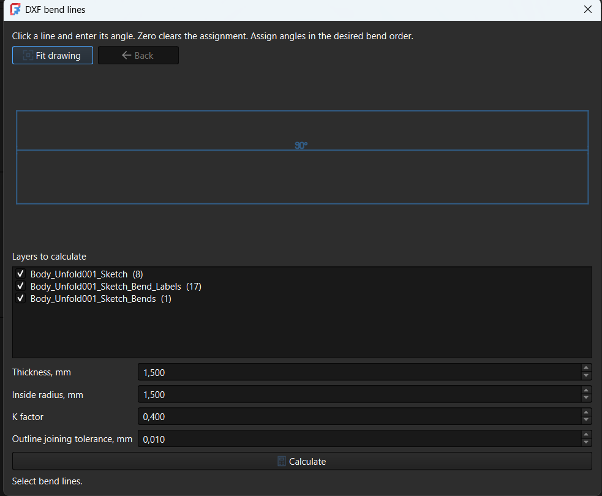
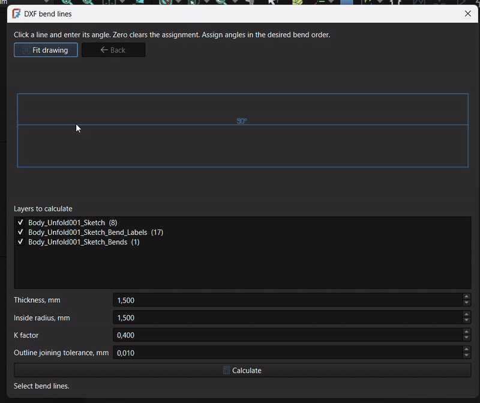
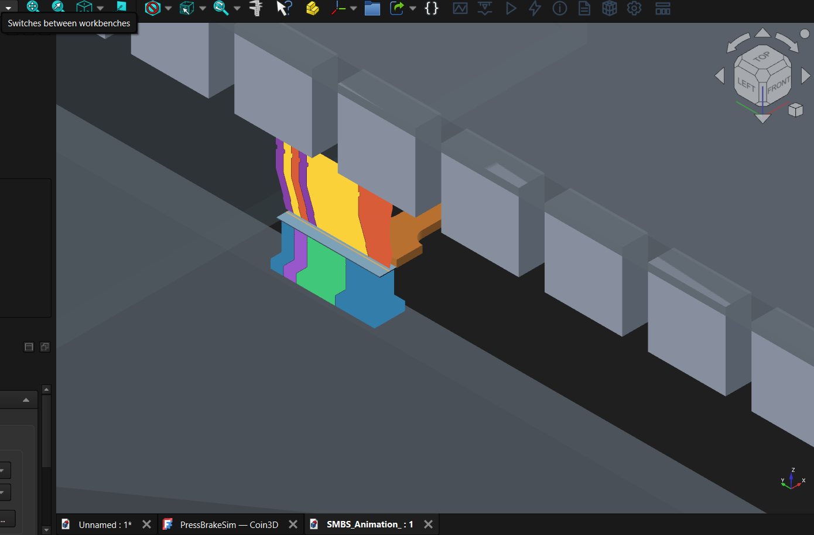
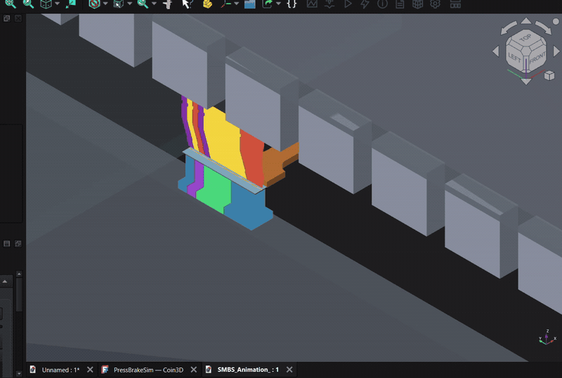
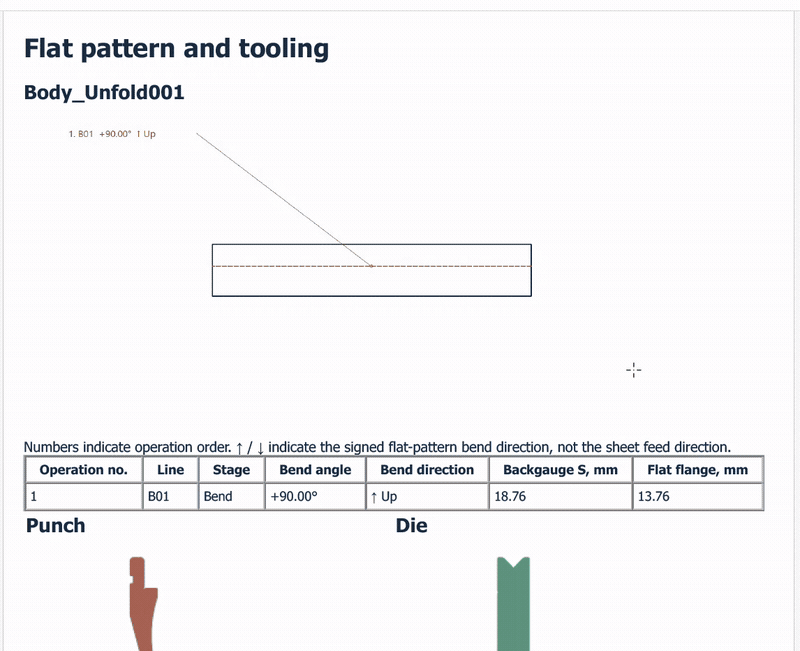

# SMBS BendSeq · PressBrakeSim 0.2.0

**SMBS BendSeq** is a FreeCAD workbench for planning press-brake operations. Start from a SheetMetal unfold or an ASCII DXF flat pattern, set the bend order manually or search for candidates with **FAST**, and preview the part and tooling in 3D. Use **Mesh 3D** to check the selected sequence for sampled tool collisions.

**Version 0.2.0 — development preview.** Native FreeCAD integration and Windows runtime checks have been improved. Full cross-platform acceptance and manufacturing validation remain pending.

[Workflow demonstrations](#workflow-demonstrations) · [Requirements](#requirements) · [Installation](#installation) · [Quick start](#quick-start) · [Collision checks](#collision-checks) · [Tooling](#tooling)

## Workflow demonstrations

The animations below play directly in the README. Click an animation or the **Watch full video** link to open the original MP4.

### 1. DXF flat pattern

Import an ASCII DXF, choose the relevant drawing layers, assign bend angles in operation order, and set the sheet thickness, inside radius, K factor and outline joining tolerance. Select **Calculate** to generate the folded part.



[](docs/media/dxf.mp4)

[▶ Watch full DXF video](docs/media/dxf.mp4)

### 2. 3D bending simulation

Preview the selected operation in the FreeCAD viewport with the workpiece, segmented punch and die, clamps and machine geometry. Inspect the setup and workpiece orientation before running sampled collision checks.



[](docs/media/bend.mp4)

[▶ Watch full Bend video](docs/media/bend.mp4)

### 3. PDF bend instructions

Export a workshop instruction sheet with the flat pattern, operation table, bend angle and direction, backgauge values, punch and die profiles, suggested segment layouts and before/after bending illustrations. Verify collision clearance separately; the illustrations are not a clearance certificate.

[](docs/media/pdf.mp4)

[▶ Watch full PDF video](docs/media/pdf.mp4)

## Requirements

| Component | What it is used for |
| --- | --- |
| **FreeCAD 1.1.x desktop** | Run the **PressBrakeSim** workbench and open or save `.FCStd` files. |
| **Pivy with Coin3D (`pivy.coin`)** | Render the 3D simulation. Use a FreeCAD build that provides Pivy in its own Python environment. |
| **SheetMetal Workbench (optional addon)** | Load a SheetMetal unfold. Install **SheetMetal** from the Addon Manager and use its **Unfold** command to prepare the part. The SMBS ASCII DXF workflow does not require SheetMetal. |
| **TechDraw workbench** | Optional. Required to create a TechDraw page from the bend table. |

To check Pivy, run this in **FreeCAD's Python console**:

```python
from pivy import coin
```

If the import fails, check whether your FreeCAD distribution provides a matching Pivy package or use a FreeCAD build that includes it. Pivy must be available to the Python runtime that FreeCAD uses.

For a tooling-based collision check, select both a punch and a die. Punch and die models are not distributed. Create original demonstration tools using the [parametric editor](docs/PARAMETRIC_TOOL_GENERATOR.md), or import your own compatible models.

## Installation

### Addon Manager

Open **Tools → Addon Manager**. If SMBS BendSeq is available in your configured addon sources, select it and install it. Restart FreeCAD and choose **PressBrakeSim** from the workbench selector.

### Manual installation

1. Download the [ZIP for the `main` branch (0.1.0)](https://github.com/Badsmc/SMBS_BendSeq/archive/refs/heads/main.zip). For the 0.2.0 development preview, use the [`develop` ZIP](https://github.com/Badsmc/SMBS_BendSeq/archive/refs/heads/develop.zip).
2. Find your user `Mod` directory by running this in FreeCAD's Python console:

   ```python
   from pathlib import Path
   import FreeCAD as App

   print(Path(App.getUserAppDataDir()) / "Mod")
   ```

3. Extract the archive into `Mod/SMBS_BendSeq/`. Keep `package.xml`, the temporary `Init.py` / `InitGui.py` entrypoints and the complete `freecad/` directory inside that folder. The implementation is in `freecad/bendseq`, including its headless `core` and resources. Do not create `freecad/__init__.py`.
4. Restart FreeCAD and select **PressBrakeSim**. SMBS displays English or Russian according to the FreeCAD language setting.

## Quick start

1. **Load a flat pattern.** Select a SheetMetal unfold in the model tree and open **Simulation**. For an ASCII DXF, open **DXF flat pattern**, enable the relevant layers, assign angles to the bend lines, and click **Calculate**.
2. **Select tooling.** Choose the punch and die under **Tooling**. For segmented tools, use **Calculate tool layout** to propose a layout from the available stock and clamp positions.
3. **Set the bend order.** Select bend lines or reorder operations in **Simulation**. To search for candidates, run **FAST**, select a sequence, and review the part orientation at each bend.
4. **Check and document the sequence.** Run **Mesh 3D**. Open **Information** to review the bend table or export it to TechDraw.

Sample models are available in [`demo/parts/`](demo/parts); see the [demo index](demo/README.md) for descriptions and collision examples.

## Collision checks

Open **Mesh 3D** in FreeCAD's **Tasks** panel. Set the time limit in seconds and the minimum penetration volume in mm³, then click **Run Mesh**. If the time limit is reached, review which operations were checked and which are still pending.

The PDF export Tasks panel has a **Separate workpiece view** selector: **3D** keeps the existing inset; **2D — Cross-section** slices the placed preview geometry at the middle of the active bend. Selecting 2D enables collision evidence by default. If the unchanged setup has recorded Mesh findings, the after-bending inset instead shows a section through a representative actual collision sample, with its phase, angle and machine X coordinate. Confirmed findings are red; conditional findings are orange. Exact retained intersection meshes and recorded overlap bounds are explicitly distinguished. Other findings remain in the collision evidence appendix; disable grouping to obtain one page per sample. A nominal section is not evidence of clearance. The left 3D view remains the nominal pose.

**Save latest collision…** exports the most recent confirmed collision for the current setup to a separate `.FCStd`. The intersecting volume is shown in red and the colliding bodies are translucent.

FAST proposes bend sequences. Mesh checks sampled positions of the part against the selected punch and die. Its result applies to the reported samples and tool geometry. Continuous motion, the backgauge, clamps and the machine frame are outside the scope of this check.

## Tooling

- **Segments.** Enter the available lengths and quantities for each punch or die. The tool's `.tooling.json` stores the inventory for reuse across parts.
- **Punch rotation.** Save a 180° rotation for a punch to use that orientation in simulation and checks.
- **Tool layout.** Configure the clamps, calculate the sections for the selected bends, and apply a common layout if needed. Recalculate after changing the available stock or clamps.

## Saving and troubleshooting

For a session linked to a SheetMetal unfold, saving the document in FreeCAD with **Ctrl+S** embeds SMBS session data in the `.FCStd`. Keep the external tooling files available when moving the project to another installation. See [FCStd save and restore](docs/FCSTD_NATIVE_AUTOSAVE.md) for details.

To investigate an error, enable **Log SMBS activity and FreeCAD crashes** in SMBS settings and reproduce the problem. The desktop log is named `SMBS_debug_log.json`. Include the FreeCAD version, the SMBS version and commit, and the steps to reproduce the issue when reporting it. [Report an issue](https://github.com/Badsmc/SMBS_BendSeq/issues).

See the [tooling library notes](freecad/bendseq/resources/default_toollibrary/README.md) for local tooling setup.

## Documentation and development

See the [documentation index](docs/README.md) for tooling, PDF export, staged bends, project persistence and development guides.

`main` contains the public 0.1.0 preview; `develop` contains the 0.2.0 development preview. See [development and releases](docs/DEVELOPMENT.md) and the [changelog](CHANGELOG.md).

Original code is licensed under [LGPL-2.1-or-later](LICENSE-Code); original non-code resources under [CC-BY-SA-4.0](LICENSE-Assets). Bundled CAD authorship is confirmed by maintainer Badsmc. See [licensing](LICENSE.md) and [CAD provenance](docs/ASSET_PROVENANCE.md).

Official Addon Manager listing and full runtime acceptance remain pending.

## Dependencies and privacy

Use FreeCAD's own Python environment. Part, the FreeCAD-provided Qt wrapper and Pivy/Coin3D are host components, not packages to install separately with pip. SheetMetal Workbench is optional for DXF use, required for SheetMetal unfolds; TechDraw is optional for drawing export. The addon does not install Python packages itself. PythonOCC is a legacy optional offline geometry reader, not needed for the native FreeCAD workflow. Named tooling sets use standard-library validation. See [submission preparation](docs/ADDON_INDEX_SUBMISSION.md) and [privacy](PRIVACY.md).

To test through Addon Manager before official indexing, add `https://github.com/Badsmc/SMBS_BendSeq` with branch `main` as a custom repository in Addon Manager preferences. Remove other SMBS installations first. Restart FreeCAD after installation.

## Native package and user data

The current development package requires FreeCAD 1.1.3+ and Python 3.11+. Install it into a single addon folder with FreeCAD closed and remove duplicate enabled installations.

Writable tooling, segment inventories, configs, templates and saved sequences are stored under `FreeCAD.getUserAppDataDir()/BendSeq/`. Existing installation data is copied and SHA-256 verified on first library access; original files and existing destination files are preserved. Conflicts are retained for review.

See [data migration, acceptance and rollback](docs/NATIVE_PACKAGE_MIGRATION.md).
