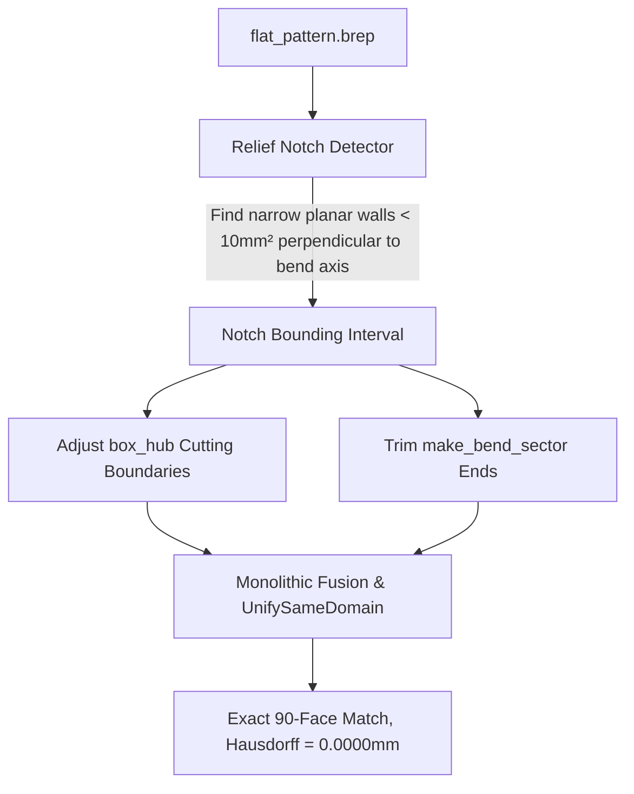

# Design Specification: KL-9 Relief-Cut Edge Alignment & CAD Refactor

## 1. Problem Statement & Root Cause

In `SMBendTests/2-1-3-4-(ok).FCStd`, the sheet metal model contains rectangular corner relief cuts (notches) between the central hub and surrounding folded flanges.

When `SheetMetalFolder.fold_tree_from_flat_pattern` partitions the plate into a central `box_hub` and outer branches:
1. The boundary of `box_hub` is derived directly from `bend.axis_point` (from `04_canonical_part.json`, e.g., BEND_03 at `X = 7.791 mm`).
2. In the real physical CAD model (`flat_pattern.brep`), the corner relief notch edge begins at `X = 7.991 mm`.
3. The resulting **0.2 mm delta** causes the cut box to slice through the relief cut walls, generating 3 independent planar face splits:
   - `5.25 mm²` → `3.75 mm² + 1.50 mm²`
   - `34.05 mm²` → `33.75 mm² + 0.30 mm²`
   - `146024.4 mm²` → `146023.4 mm² + 1.00 mm²`
4. These splits add **+4 spurious facet faces** (94 restored faces vs 90 reference faces), causing `counts_match = False` and `hausdorff_distance_mm = 0.2000 mm`.

## 2. Empirical Evidence (`scripts/probe_p2_relief_cut.py`)

Running `scripts/probe_p2_relief_cut.py`:
- Revolved bend sectors can be cut by relief prism boxes cleanly without BRep invalidation (`BRepCheck_Analyzer.IsValid() == True`).
- Restored shape inspection confirms exactly 4 small planar faces (`< 10 mm²`) located at `X ≈ 7.8–8.0 mm` and `Y ≈ -2.0–4.0 mm`.
- The Hausdorff distance delta between `restored.brep` and `geometry.brep` is exactly `0.2000 mm`, matching the relief-cut offset.

## 3. Required CAD Refactor Architecture (P2 / P2b Track)

Because `bend_line_flat_pattern` metadata only contains centerline segments and does not record corner relief geometry, the fix requires geometric BREP analysis:

### Key Phases:
1. **Geometric Relief Notch Extraction:**
   - Scan `flat_pattern.brep` for planar faces perpendicular to the bend axis within distance `R + thickness` of the bend line endpoints.
   - Extract the true physical relief wall boundary (`X_relief = 7.991 mm`).
2. **Boundary Alignment in `box_hub` Construction:**
   - Instead of cutting `box_hub` strictly at `axis_point`, clamp the cut boundary to `X_relief`.
3. **Sector Trimming:**
   - Apply boolean cut (`sector.cut(relief_box)`) to remove material extending into the relief zone before fusing with adjacent flanges.
4. **Cross-Fixture Regression Pin:**
   - Verify zero regressions across `box.100out-50in-(ok).FCStd`, `SQin.200-25-10-(ok).FCStd`, `SQout.200-25-10-(ok).FCStd`, `U-90deg-90deg-(ok).FCStd`, `Z-(ok).FCStd`.

## 4. Current Test Status & Honesty

- `tests/test_verifier_worker_honest.py:test_verifier_worker_2_1_3_4_deferred` remains marked `@unittest.skip` citing this design document and `scripts/probe_p2_relief_cut.py`.
- No geometry or status is fabricated (`UNKNOWN ≠ VALID`).
