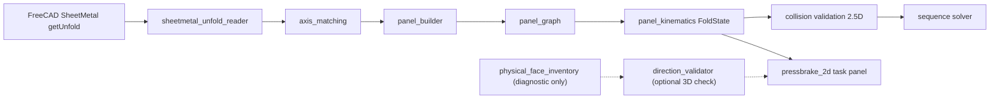

# PressBrakeSim 2.5D — Authoritative Roadmap

Branch: `2D` · Baseline commit: `e8f2ed1` · Target: FreeCAD 1.1.x, Python 3.11, SheetMetal WB.
Live evidence/status: see `docs/PRESSBRAKESIM_25D_STATUS.md`.

## 1. Objective and scope

A fast, deterministic, physically credible **2D/2.5D** press-brake simulator inside FreeCAD.
It is NOT a full 3D simulation engine.

In scope: rigid planar panels, finite-radius bend zones, thickness, signed angles, bend
axes, panel tree kinematics, tool profiles, 2D/2.5D collision checks, sequence search, UI.

Excluded: per-frame / per-candidate 3D OCC Booleans, FEM/springback, generic 3D collision.
A 2D collision-free result never implies 3D collision freedom; unsupported checks return
`UNKNOWN`/`UNVERIFIED`, never `PASS`.

## 2. Target architecture

| Module | Responsibility | Runtime dependency |
|---|---|---|
| `freecad_smbs/integration/sheetmetal_unfold_reader.py` | Read `BendInfo` (angle, radius, axis) from SheetMetal; fail closed on CSV/spreadsheet K-factor | FreeCAD + SheetMetal |
| `smbs_core/kinematics2d/axis_matching.py` | Unique geometric matching of bend axes to `_Sketch_Bends` lines | Pure Python |
| `freecad_smbs/integration/panel_builder.py` | Split flat outline into material islands by narrow separator strips; build panel connections | FreeCAD Part (2D planar cut, once per build) |
| `smbs_core/kinematics2d/panel_graph.py` | Panel/bend tree, rooting at fixed panel, ambiguity rejection | Pure Python |
| `smbs_core/kinematics2d/panel_kinematics.py` | Absolute-angle rigid hinge transforms | Pure Python |
| `smbs_core/kinematics2d/fold_sequence.py`, `engine.py` | Sequence replay helpers | Pure Python |
| `freecad_smbs/commands/pressbrake_2d.py` | 2D task panel UI (slider, play, reset, fit, diagnostics) | FreeCAD GUI |
| `freecad_smbs/integration/direction_validator.py` | Conservative reference 3D sign validation | FreeCAD (validation only) |
| `freecad_smbs/integration/physical_face_inventory.py` | Read-only face pairing diagnostic. **Must stay optional.** | FreeCAD |
| `smbs_core/Geometry/feature_extractor.py`, `Core/bend_transform.py`, `Physics/*`, `Solvers/*`, `workers/*` | Legacy 3D/OCC pipeline (HandMod lineage). Reuse concepts, not the OCC dependency. | pythonocc |

## 3. Data contracts and coordinate systems

- **Sketch frame (SF):** SheetMetal `move_to_origin` frame; flat pattern in z=0. `BendInfo.line`
  and `_Sketch_Bends` lines live here. `getUnfold()[2]` (`trimmed_bend_lines`) is transformed
  back to the **source local frame** — never mix it with `BendInfo.line` without the transform.
- **Source local frame:** body shape with placement removed (`getUnfold` line 1488).
- **World frame:** document placement.
- `BendRecord2D`: `bend_id`, `source_angle_deg` (SheetMetal signed included-complement), `fold_angle_deg`
  = sign·(180−|angle|), `radius_mm` (reference-face cylinder radius), axis endpoints (SF).
- **Bend line semantics (confirmed from SheetMetal source `unroll_cylinder`, L1208–1232):** the bend
  line is the **centerline of the bend-allowance zone** (offset BA/2 from each tangent line).
- **Consequence:** every PanelBuilder flat panel = planar source face + (BA − w)/2 strip per
  adjacent bend (w = separator width 0.02 mm). Verified exactly on L and U models (Phase 2 iter. 1).
- Missing contract items (Phase 1): thickness and K-factor not yet carried in `BendRecord2D`.

## 4. Phases

Maturity levels: `DECLARED → IMPLEMENTED → TESTED → VERIFIED → QUALIFIED → PRODUCTION_READY`.

| Phase | Goal | Acceptance |
|---|---|---|
| 0 Baseline | Audit, baseline tests, actual architecture | Baseline SHA, tests run, failures documented |
| 1 Geometry contract | Signed angles, r, t, K, stable IDs, frames, reject ambiguity | Consistent bend data on all fixtures; no silent fallback |
| 2 Panels + bend zones | Separate rigid panels (tangent-line bounded) from finite bend zones (width BA) | Panel dims match planar source faces with no unexplained constants; L/U/multi-bend validated |
| 3 Kinematics | Finite-radius bend-zone kinematics, signed, subtree, reversible | Flat→Folded→Flat repeatable; folded matches source within tolerance |
| 4 UI/animation | Load, Build, Fixed Panel, Bend List, Slider, Play/Pause/Prev/Next/Reset/Fit, Collision, Find Sequence, Export | Controls enabled only when prerequisites hold; no placeholders |
| 5 Tooling/collision | Punch/die profiles, contact, clearances, backgauge, broad phase | PASS/FAIL/UNKNOWN; known valid pass, invalid fail |
| 6 Sequence | Manual validation, greedy, DFS backtracking, optional A* (reuse `smbs_core/Solvers`) | Every sequence replayable; failures carry reasons |
| 7 Release | Regression, real models, perf, install, docs | Milestones v0.6…v1.0 (planned, not claims) |

### Phase 2 plan (current priority)
1. ✅ Trace flat→panel path; confirm bend-line semantics (BA centerline).
2. ✅ Explain contour diagnostic mismatches on L and U (validation mismatch, not geometry defect).
3. ☐ Add `thickness_mm`, `k_factor`, `bend_allowance_mm` to the bend contract (from SheetMetal calculator, no defaults).
4. ☐ Represent bend zone explicitly: two tangent lines at ±BA/2 from the axis; rigid panel = island minus half-zone.
5. ☐ Replace area-vs-single-face contour check with per-panel tangent-line-bounded comparison.
6. ☐ Explain the remaining 2-1-3-4 residuals (P06–P11, ≤0.86 mm²) with a per-edge test before any change.

### Phase 3 note (known modelling limitation)
`panel_kinematics.hinge_transform` rotates about the zero-radius BA centerline. Combined with
panels that include BA/2, this is a sharp-hinge approximation: flange positions differ from
the real formed part by an amount depending on r, t, K. Finite-radius bend-zone kinematics is
required for VERIFIED status.

## 5. UI control activation rules
- Build 2.5D: requires active doc with SheetMetal unfold available.
- Fixed panel / Bend list / Slider / Play / Reset / Fit: require successful build.
- Collision Check / Find Sequence: require build + tooling selected; return UNKNOWN when unsupported.
- Export Report: requires at least one computed result.

## 6. Collision validation limits
2D section checks prove nothing outside the modelled section planes. Longitudinal extents and
out-of-section features → `UNKNOWN` unless explicitly modelled.

## 7. Test strategy
- Level A: pure Python (`tests/`, venv + pytest). Level B: `freecadcmd` scripts on real fixtures
  (`~/Desktop/bend_Seq/BendSeq_Fixtures_Source`, 16 FCStd). Level C: interactive FreeCAD (manual).
- CI (`.github/workflows/ci.yml`) runs Level A with pythonocc via micromamba.

## 8. Known defects and risks
See STATUS file §Defects. Key risks: legacy OCC pipeline duplicates geometry concepts; sharp-hinge
kinematics; K-factor tables unsupported (fail closed); fixtures are outside the repository.
